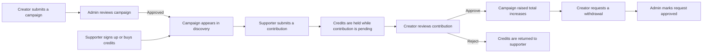

# SeedInvest

### A crowdfunding prototype for ideas that need a first group of supporters.

SeedInvest brings campaign creators, supporters, and platform administrators into one workflow. Creators can propose a project, supporters can discover it and contribute platform credits, and administrators can review campaigns before they appear publicly.

> **Project status:** SeedInvest is a full-stack learning/prototype project. It demonstrates a crowdfunding workflow; it is not an investment service, escrow provider, or production-ready payment platform.

## Contents

- [The problem it explores](#the-problem-it-explores)
- [How SeedInvest works](#how-seedinvest-works)
- [Features by role](#features-by-role)
- [Credits, payments, and withdrawals](#credits-payments-and-withdrawals)
- [Design choices](#design-choices)
- [Limitations and edge cases](#limitations-and-edge-cases)
- [Run it locally](#run-it-locally)
- [Project structure](#project-structure)
- [Technology](#technology)

## The problem it explores

A person with a useful idea may have trouble explaining it, finding interested supporters, and keeping track of contributions. A supporter may have trouble discovering projects and seeing whether a campaign has been reviewed. SeedInvest explores one shared place for those steps:

- A creator explains a project, its funding goal, and its deadline.
- A supporter browses campaigns and chooses whether to contribute.
- A review process makes campaign and contribution status visible to the people involved.
- An administrator has queues for campaign approvals, reports, users, and withdrawal requests.

The goal is to make the workflow understandable and traceable. The app does not verify that a project will succeed, guarantee a return, or replace legal, financial, or payment-provider safeguards.

## How SeedInvest works



In plain language: **campaign review happens before discovery; contribution review happens after a supporter submits; a creator's raised total changes only when a contribution is approved.**

## Features by role

### Visitors

- Browse the landing page and featured campaigns.
- Search campaigns by title, filter by category, and sort by newest, deadline, or funding progress.
- Open campaign pages to read the story, see the goal and deadline, check the minimum contribution, view rewards, and see approved backers.

### Supporters

- Create an account as a supporter or sign in with email and password.
- Optionally use Google sign-in when OAuth is configured.
- Start with 50 credits in a newly registered supporter account.
- Buy credit packages, contribute to an eligible campaign, and see contribution status and payment history.
- Report a campaign to the administrator.
- Receive in-app notifications about contribution decisions and other account activity.

### Creators

- Start with 20 credits in a newly registered creator account.
- Submit a campaign story, category, funding goal, minimum contribution, deadline, optional reward information, and cover image.
- Track campaign status and funding progress; edit campaign text or delete a campaign.
- Review contributions to their campaigns and approve or reject pending ones.
- Request a withdrawal and view withdrawal history.

### Administrators

- Review new campaigns and approve or reject them.
- Manage users and account roles, and view platform summary figures.
- View or remove campaigns, review user reports, and suspend or delete a reported campaign.
- Review withdrawal requests and mark a request approved after handling the payment separately.

## Credits, payments, and withdrawals

Credits are an internal platform balance used by the current app. They are not shares, ownership, a promise of profit, or a direct transfer to a creator.

| Action                | What currently happens                                                                                                                                                                    |
| --------------------- | ----------------------------------------------------------------------------------------------------------------------------------------------------------------------------------------- |
| New supporter account | Receives 50 credits.                                                                                                                                                                      |
| New creator account   | Receives 20 credits.                                                                                                                                                                      |
| Buy credits           | The app offers several packages. With a Stripe secret configured, it starts a Stripe Checkout session. Without Stripe, the server creates an immediate **dummy payment** for development. |
| Submit contribution   | The supporter must have enough credits and meet the campaign minimum. Credits are deducted and the contribution is marked pending.                                                        |
| Approve contribution  | The campaign's raised total increases and the supporter can see the contribution among approved backers.                                                                                  |
| Reject contribution   | The contribution is rejected and its credits are returned to the supporter.                                                                                                               |
| Request withdrawal    | A creator needs at least 200 available credits. The current server calculates withdrawals at 20 credits per US dollar.                                                                    |
| Approve withdrawal    | The request status changes to approved and the creator is notified. The app does not send the money.                                                                                      |

## Design choices

### Why review campaigns before publishing?

Approval keeps newly submitted campaigns out of public discovery until an administrator reviews them. It gives the platform a moderation step, but it is not proof that a campaign is legitimate or that its claims are true.

### Why use credits instead of direct supporter-to-creator transfers?

Credits let this prototype model balances, contributions, refunds, and review status in one application flow. This makes the workflow easier to demonstrate. The tradeoff is that pricing, refunds, custody of funds, withdrawal accounting, and compliance become the platform's responsibility. A credit balance alone is not a payment or escrow system.

### Why are contributions reviewed by the creator?

The project models a second decision after the campaign is approved: a creator can accept or reject a contribution. Until that decision, the supporter does not see the amount included in the campaign's raised total. Rejections return the contribution credits.

## Limitations and edge cases

These are important when evaluating the code or planning real deployment:

- **Not an investment product:** SeedInvest does not issue equity, promise a return, or validate campaign claims. Do not describe a contribution as an investment based on this app.
- **No automatic creator payout:** Admin approval records a status change; money must be handled outside this app. There is no integrated payout provider or escrow ledger.
- **Development payment fallback:** If `STRIPE_SECRET_KEY` is absent, credit purchases succeed as dummy payments. This is for local development only and must not be available in a real-money deployment.
- **Payment confirmation needs production hardening:** The current checkout flow confirms from the client return path. `STRIPE_WEBHOOK_SECRET` is present in the example environment file, but the server code does not currently implement a Stripe webhook handler.
- **Credit conversion needs a product decision:** Purchase package prices and the withdrawal rate are not one symmetric conversion. The withdrawal rate is 20 credits per dollar, while purchase packages use their own prices. Define and explain a consistent policy before handling real money.
- **Campaign visibility differs by page:** Campaign discovery excludes expired campaigns, but the top-funded homepage endpoint currently filters by approval status without checking the deadline. It may show an expired campaign.
- **Unapproved campaign details need a server-side access check:** Discovery hides unapproved campaigns, but the public detail endpoint currently looks up a campaign by ID without filtering its status. Review this before exposing private or unapproved campaign content.
- **Campaign deletion and pending contributions:** Deleting a campaign refunds approved contributions. The current deletion routine does not include pending contributions, so pending items should be resolved before deletion; transaction handling also needs strengthening.
- **Multi-step balance changes are not transactional:** Some operations update a user's balance and a separate campaign or contribution record in multiple database writes. Production use should make these updates atomic and resilient to partial failure or concurrent requests.
- **Demo seeding is unsafe for production:** `server/src/seed.js` contains demo accounts and known fallback credentials, and it logs the admin password. Do not run the seed script against a production database. Replace its defaults and logging before deployment.
- **Browser configuration is public:** Any client variable beginning with `NEXT_PUBLIC_` is bundled for browser use. Do not put private API, payment, or database secrets there. The optional imgBB key is used by the browser and should be treated as exposed.
- **Browser token storage needs review:** The client stores its login token in `localStorage`. A production deployment should assess script-injection defenses and whether a hardened cookie-based session better fits its security needs.
- **No dedicated frontend test suite is configured:** The client has lint and build scripts. The server has an integration-style smoke script using an in-memory MongoDB; neither replaces security review or production payment tests.

## Run it locally

### Requirements

- Node.js 20.9 or newer and npm.
- MongoDB running locally, or a MongoDB connection string you can use.
- Optional: Google OAuth credentials, a Stripe secret key, and an imgBB API key for the corresponding integrations.

The commands below use PowerShell. If you use Bash, replace `Copy-Item source destination` with `cp source destination`.

### 1. Configure and start the API

From the repository root:

```powershell
cd server
npm ci
Copy-Item .env.example .env
```

Edit `server/.env`. Set at least `MONGODB_URI` to a reachable database and `JWT_SECRET` to a long, unique random value. Set `CLIENT_URL` to the client origin, normally `http://localhost:3000`. Leave payment and OAuth integrations unset if you are only exploring locally; remember that purchases then use the dummy-payment path.

Start the API:

```powershell
npm run dev
```

The API listens on port 5000 by default. Check that it responds at [http://localhost:5000/api/health](http://localhost:5000/api/health).

### 2. Configure and start the client

Open a second terminal from the repository root:

```powershell
cd client
npm ci
Copy-Item .env.local.example .env.local
npm run dev
```

The default `NEXT_PUBLIC_API_URL` is `http://localhost:5000/api`. Open [http://localhost:3000](http://localhost:3000) to use the app.

If the API runs at a different address, update `NEXT_PUBLIC_API_URL` in `client/.env.local`. Restart the client after changing environment variables.

### Environment variables

The server reads its settings from `server/.env`:

| Variable                        | Purpose                                                                   |
| ------------------------------- | ------------------------------------------------------------------------- |
| `PORT`                          | API port; defaults to `5000`.                                             |
| `MONGODB_URI`                   | MongoDB connection string; required.                                      |
| `JWT_SECRET`                    | Secret used to sign login tokens; use a unique random value.              |
| `JWT_EXPIRES_IN`                | Token lifetime; defaults to `7d`.                                         |
| `CLIENT_URL`                    | Allowed browser origin for CORS and Stripe return URLs.                   |
| `GOOGLE_CLIENT_ID`              | Google sign-in verification; optional.                                    |
| `STRIPE_SECRET_KEY`             | Enables Stripe Checkout; without it, development purchases are simulated. |
| `ADMIN_EMAIL`, `ADMIN_PASSWORD` | Used by the development seed script. Do not rely on the example defaults. |

The client reads settings from `client/.env.local`:

| Variable                       | Purpose                                                                     |
| ------------------------------ | --------------------------------------------------------------------------- |
| `NEXT_PUBLIC_API_URL`          | Backend API base URL; defaults to `http://localhost:5000/api`.              |
| `NEXT_PUBLIC_GOOGLE_CLIENT_ID` | Enables the Google sign-in button when configured.                          |
| `NEXT_PUBLIC_IMGBB_API_KEY`    | Enables browser-side image uploads; entering an image URL works without it. |

Never commit real `.env` or `.env.local` files. The `STRIPE_WEBHOOK_SECRET` value appears in the server example but is not currently used by a webhook route.

### Optional development data and checks

`npm run seed` in `server/` inserts demo users and sample campaigns. It uses development credentials in the current implementation, so use only with a disposable local database and review the seeder before running it.

Run the server smoke test with `npm run smoke` from `server/`. It starts an in-memory MongoDB and exercises core account, campaign, contribution, payment-fallback, withdrawal, and report flows.

From `client/`, useful checks are:

```bash
npm run lint
npm run build
```

## Project structure

```text
client/                 Next.js frontend
  src/app/              Public pages and role-specific dashboards
  src/components/       Shared UI components
  src/context/          Authentication state
  src/lib/              API client and frontend helpers

server/                 Express and MongoDB API
  src/controllers/      Request and workflow logic
  src/models/           MongoDB data models
  src/routes/           API route definitions
  src/middleware/       Authentication, validation, and errors
  scripts/              Smoke test
```

The API is grouped under `/api`: `auth`, `campaigns`, `contributions`, `payments`, `withdrawals`, `users`, `notifications`, and `reports`. The health check is `/api/health`.

## Technology

- **Frontend:** Next.js App Router, React, Tailwind CSS, Axios, Swiper, Lucide, and React Hot Toast.
- **Backend:** Node.js, Express, MongoDB with Mongoose, JWT authentication, password hashing, and request validation.
- **Optional integrations:** Google OAuth, Stripe Checkout, and imgBB image hosting.

## Production readiness

Before handling real users or money, review the seed credentials, payment confirmation and webhook strategy, withdrawal fulfillment, credit conversion policy, transactional balance updates, authorization rules, data privacy, and applicable legal or regulatory requirements. The current setup is suitable for local exploration and further development, not for processing real financial activity.
